# Informe técnico — Reto 3: Recuperación y fortalecimiento del analizador semántico

**Examen práctico:** Evolución y fortalecimiento del Portal Integrado de OVAs — Teoría de Compiladores 2026-II
**Grupo 3:** Klivert Chiquiza · Ricardo Mendoza · Rafael Ruiz
**Proyecto de referencia:** Compilador Semántico Web (autores originales: Gabriel Argenis Medina Carrero y Kevin Garcia)
**Docente:** Msc. IS. Alvaro Salamanca Landínez
**Versión entregada:** v1.6.0 (versión recibida: v1.5.7)

---

## 1. Arquitectura del proyecto

La herramienta es una aplicación web estática, sin backend: `index.html` (estructura), `styles.css` (estilos) y `analyzer.js` (todo el analizador). En producción se sirve con Nginx en Docker (`Dockerfile`, `docker-compose.yml`). Como no hay backend, no hay endpoints ni dependencias de servidor que verificar; todo el análisis ocurre en el navegador.

Flujo interno de `analyze(source)` en `analyzer.js`:

1. **Léxico:** `tokenizeLine()` separa cada línea en tokens (palabra reservada, identificador, número, cadena, operador, símbolo o no reconocido).
2. **Sintáctico:** cada sentencia se clasifica (declaración, asignación, `imprimir`, `si`, `sino`, bloque) y se valida su forma (`;`, `=`, paréntesis, llaves).
3. **Semántico:** `evaluateExpression()` es un parser descendente recursivo (`||` → `&&` → `==`/`!=` → `<`/`>`… → `+`/`-` → `*`/`/`/`%` → unarios → primarios) que infiere el tipo de cada expresión. La tabla de símbolos (`symbols`) guarda nombre, tipo, ámbito, línea y valor; la pila `scopes` (`global`, `bloque_1`, …) controla la visibilidad.
4. **Salida:** `renderAnalysis()` muestra veredicto, errores, tabla de símbolos, tokens, código intermedio y explicación paso a paso.

## 2. Diagnóstico: fallas encontradas, reproducción y causa

Cada falla se reprodujo ejecutando `analyze()` de la versión original (v1.5.7) con el script `tests/pruebas-semanticas.test.js`. Con la versión original pasaban **19 de 31** pruebas; con la versión corregida pasan **31 de 31**.

| # | Falla | Cómo reproducirla (v1.5.7) | Causa identificada |
|---|---|---|---|
| D1 | Solo se analiza **una sentencia por línea**. `int x; int x;` no reporta declaración duplicada sino tres errores de sintaxis falsos; un bloque `si (c) { ... }` escrito en una línea falla. | Escribir `entero x; entero x;` en una sola línea → "No se pudo asociar 'x' con '; entero x' porque falta el operador '='". | `analyze()` recorre `source.split('\n')` y trata **todos** los tokens de la línea como una sola instrucción: `declare()` toma el segundo token como nombre y el resto como "valor". |
| D2 | Los casos del enunciado (`int x = 10;`, `int x = "hola";`, …) se interpretan como asignaciones a una variable llamada `int`. `int x = "hola";` **no** reporta incompatibilidad de tipos. | `int x = 10;` → "La variable 'int' se usa como destino de una asignación, pero no fue declarada". | `TYPE_KEYWORDS` solo contiene `entero`, `decimal`, `texto`, `logico`; `int` se tokeniza como identificador y la línea cae en `assign()`. Igual con `true`/`false`. |
| D3 | Los errores **léxicos** se reportan como "Sintaxis" y el carácter inválido genera errores en cascada. | `entero n = 5 @ 3;` → dos errores "Sintaxis" (carácter `@` y "tokens sobrantes '@ 3'"). | En `analyze()` los errores de carácter no reconocido, cadena sin cerrar y número con varios puntos se creaban con `issue('Sintaxis', …)`, y el token `unknown` seguía dentro de la sentencia. |
| D4 | Sin **recuperación** ante un tipo mal escrito: el ejemplo "con errores" de la propia app oculta el error de tipos que pretende mostrar. | Botón *Ejemplo con errores*: `eentero edad = 20;` hace que `edad` nunca se registre, y luego `edad = nombre;` dice "edad no fue declarada" en lugar de "no se puede asignar texto a entero". | `eentero` se toma como identificador (asignación mal formada) y la variable no entra a la tabla de símbolos, provocando errores semánticos en cascada. |
| D5 | La tabla de símbolos no registra si la variable tiene valor: usar una variable declarada sin inicializar pasa sin aviso. | `entero w;` y luego `entero k = w + 1;` → "sin errores". | El símbolo solo guardaba `value: 'sin inicializar'` como texto; ninguna regla lo consultaba. |
| D6 | El veredicto y el contador no diferencian errores por fase. | Cualquier programa con errores → "Se encontraron N error(es) de sintaxis o semántica". | `renderAnalysis()` contaba todo el arreglo `errors` sin distinguir `kind`. |

## 3. Cambios implementados y justificación técnica

| Cambio | Archivo / función | Justificación |
|---|---|---|
| Nueva función `splitStatements()`: divide cada línea en sentencias en cada `;` fuera de paréntesis, en cada `{` y en cada `}`. El cuerpo de `analyze()` ahora recorre las sentencias de cada línea. | `analyzer.js` — `analyze()`, `splitStatements()` | Corrige D1 sin reescribir el analizador: se conserva el análisis por línea (y por tanto los mensajes de "falta `;`" en la línea correcta), pero cada sentencia se analiza por separado. |
| Alias de tipos estilo C: `int`→`entero`, `float`/`double`→`decimal`, `string`→`texto`, `bool`/`boolean`→`logico`; literales `true`/`false`. Nueva función `canonicalType()`. | `analyzer.js` — `TYPE_ALIASES`, `BOOLEAN_LITERALS`, `canonicalType()`, `declare()`, `parsePrimary()` | Corrige D2. No cambia el minilenguaje: cada alias se traduce al tipo existente, así que las reglas de tipos son las mismas. Permite que los casos del enunciado se analicen tal como están escritos. |
| Errores de carácter no reconocido, cadena sin cerrar y número mal formado ahora son de tipo **Léxico**; los tokens no reconocidos se excluyen de la sentencia después de reportarse. | `analyzer.js` — `analyze()` | Corrige D3: el enunciado exige errores semánticos diferenciados de los léxicos y sintácticos, y se evita el error en cascada. |
| Recuperación de errores: si una sentencia empieza con dos identificadores y el primero se parece a un tipo (distancia de Levenshtein ≤ 2), se reporta "El tipo de dato 'eentero' no existe. ¿Quisiste decir 'entero'?" y la variable se registra con ese tipo. Nueva función `similarTypeWord()`. | `analyzer.js` — `analyze()`, `declare(forcedType)`, `similarTypeWord()` | Corrige D4. Con esto el ejemplo con errores vuelve a mostrar los 8 errores que pretende enseñar (incluida la incompatibilidad `edad = nombre`). |
| Campo `initialized` en cada símbolo; se marca al declarar con valor o al asignar. Usar una variable sin valor genera una **Advertencia** (severidad baja). | `analyzer.js` — `declare()`, `assign()`, `parsePrimary()` | Corrige D5 y hace más confiable la tabla de símbolos. Es advertencia y no error porque el programa sigue siendo válido según el lenguaje. |
| Veredicto con desglose ("N error(es): x léxico(s), y sintáctico(s) y z semántico(s)"); las advertencias no cuentan como error y se muestran con color ámbar. Nueva función `countByKind()`. | `analyzer.js` — `renderAnalysis()`, `renderErrors()`; `styles.css` — `.error-kind.warn` | Corrige D6. |
| Versión de los recursos estáticos `?v=1.6.0`; documentación de la demo menciona alias y fases de error. | `index.html` | Obliga al navegador a cargar el JS/CSS nuevos (evita caché de la versión anterior). |
| Script de pruebas reproducibles con 31 casos. | `tests/pruebas-semanticas.test.js` (nuevo) | Evidencia verificable y prueba de regresión que se puede repetir tras cada cambio. |
| Documentación actualizada. | `README.md`, `CHANGELOG.md`, `docs/07-pruebas-de-errores.md`, `docs/09-manual-tecnico-codigo.md`, este informe | Registro de cambios y limitaciones. |

No se eliminaron archivos, funcionalidades, créditos ni elementos de la identidad visual. No se agregaron dependencias, claves ni datos personales.

## 4. Cómo ejecutar y probar

- **Aplicación:** abrir `index.html` en el navegador, o `docker compose up -d --build` y entrar a `http://localhost:8097`. Las rutas a `styles.css`, `analyzer.js` y `assets/` son relativas, por lo que funcionan igual dentro del portal de la OVA.
- **Pruebas automáticas** (requiere Node.js 16 o superior), desde la raíz del proyecto:

```bash
node tests/pruebas-semanticas.test.js
```

Para comparar con otra versión del analizador: `node tests/pruebas-semanticas.test.js ruta/a/analyzer.js`.

## 5. Matriz de pruebas

Resultados obtenidos ejecutando `tests/pruebas-semanticas.test.js` sobre la v1.6.0. La última columna indica qué pasaba con la versión recibida (v1.5.7). En la columna de entrada, ⏎ representa un salto de línea.

| ID | Grupo | Entrada / escenario | Resultado esperado | Resultado obtenido (v1.6.0) | Estado | Observaciones (versión anterior v1.5.7) |
|---|---|---|---|---|---|---|
| P-01 | Enunciado | `int x = 10;` | Declaración válida; x registrada como entero | Sin errores | Aprobado | Antes fallaba: 1 Semántico — L1: La variable 'int' se usa como destino de una asignación, pero no fue declarada. |
| P-02 | Enunciado | `x = 20;` | Error semántico: variable no declarada | 1 Semántico — L1: La variable 'x' se usa como destino de una asignación, pero no fue declarada. | Aprobado | Ya funcionaba; se mantiene (regresión). |
| P-03 | Enunciado | `int x; int x;` | Error semántico: declaración duplicada en el mismo ámbito | 1 Semántico — L1: La variable 'x' ya fue declarada en el ámbito 'global'. | Aprobado | Antes fallaba: 2 Semántico, 2 Sintaxis — L1: La variable 'int' parece ser una variable de asignación, pero no fue declarada. \| L1: No se pudo asociar 'int' con 'x ; … |
| P-04 | Enunciado | `int x = 10 + 2;` | Operación válida | Sin errores | Aprobado | Antes fallaba: 1 Semántico — L1: La variable 'int' se usa como destino de una asignación, pero no fue declarada. |
| P-05 | Enunciado | `int x = "hola";` | Error semántico: tipos incompatibles (texto → entero) | 1 Semántico — L1: No se puede asignar una expresión de tipo 'texto' a la variable 'x' de tipo 'entero'. | Aprobado | Antes fallaba: 1 Semántico — L1: La variable 'int' se usa como destino de una asignación, pero no fue declarada. |
| P-06 | Declaraciones | `entero x = 10;` | Declaración válida | Sin errores | Aprobado | Ya funcionaba; se mantiene (regresión). |
| P-07 | Declaraciones | `entero x; entero x;` | Error semántico: duplicada (misma línea) | 1 Semántico — L1: La variable 'x' ya fue declarada en el ámbito 'global'. | Aprobado | Antes fallaba: 3 Sintaxis — L1: No se pudo asociar 'x' con '; entero x' porque falta el operador '='. \| L1: Token inesperado en la expresión: ';'. \| L1: Hay tokens s… |
| P-08 | Declaraciones | `entero x; ⏎ entero x;` | Error semántico: duplicada (líneas distintas) | 1 Semántico — L2: La variable 'x' ya fue declarada en el ámbito 'global'. | Aprobado | Ya funcionaba; se mantiene (regresión). |
| P-09 | Declaraciones | `entero x = 10; x = 20;` | Válido: declaración y asignación en una línea | Sin errores | Aprobado | Antes fallaba: 1 Sintaxis — L1: Hay tokens sobrantes en la expresión: '; x = 20'. |
| P-10 | Tipos | `texto t = "a"; ⏎ entero n = t;` | Error semántico: texto → entero | 1 Semántico — L2: No se puede asignar una expresión de tipo 'texto' a la variable 'n' de tipo 'entero'. | Aprobado | Ya funcionaba; se mantiene (regresión). |
| P-11 | Tipos | `decimal d = 5;` | Válido: entero se promueve a decimal | Sin errores | Aprobado | Ya funcionaba; se mantiene (regresión). |
| P-12 | Tipos | `entero e = 4.5;` | Error semántico: decimal → entero (pérdida de decimales) | 1 Semántico — L1: No se puede asignar una expresión de tipo 'decimal' a la variable 'e' de tipo 'entero'. | Aprobado | Ya funcionaba; se mantiene (regresión). |
| P-13 | Tipos | `logico l = 5;` | Error semántico: entero → logico | 1 Semántico — L1: No se puede asignar una expresión de tipo 'entero' a la variable 'l' de tipo 'logico'. | Aprobado | Ya funcionaba; se mantiene (regresión). |
| P-14 | Tipos | `entero a = 1; ⏎ texto b = "x"; ⏎ entero c = a + b;` | Error semántico: '+' entre entero y texto | 1 Semántico — L3: El operador '+' no es compatible con 'entero' y 'texto'. | Aprobado | Ya funcionaba; se mantiene (regresión). |
| P-15 | Tipos | `texto t = "a"; ⏎ logico r = t == 5;` | Error semántico: comparación texto con entero | 1 Semántico — L2: No se puede comparar 'texto' con 'entero' usando '=='. | Aprobado | Ya funcionaba; se mantiene (regresión). |
| P-16 | Tipos | `bool b = true;` | Válido: alias bool y literal true | Sin errores | Aprobado | Antes fallaba: 2 Semántico — L1: La variable 'bool' se usa como destino de una asignación, pero no fue declarada. \| L1: La variable 'true' se usa en una expresión, p… |
| P-17 | Tipos | `entero e = 1; ⏎ si (e) { ⏎ }` | Error semántico: condición no lógica | 1 Semántico — L2: La condición de 'si' debe ser de tipo 'logico', pero se recibió 'entero'. | Aprobado | Ya funcionaba; se mantiene (regresión). |
| P-18 | Ámbitos | `entero a = 1; ⏎ si (a > 0) { ⏎   entero a = 2; ⏎ }` | Válido: misma variable en ámbitos distintos (sombra) | Sin errores | Aprobado | Ya funcionaba; se mantiene (regresión). |
| P-19 | Ámbitos | `si (verdadero) { ⏎   entero y = 1; ⏎ } ⏎ imprimir(y);` | Error semántico: y no es visible fuera del bloque | 1 Semántico — L4: La variable 'y' se usa en una expresión, pero no fue declarada. | Aprobado | Ya funcionaba; se mantiene (regresión). |
| P-20 | Ámbitos | `si (verdadero) { entero y = 1; imprimir(y); }` | Válido: bloque completo en una sola línea | Sin errores | Aprobado | Antes fallaba: 2 Sintaxis — L1: Hay tokens sobrantes en la expresión: ') { entero y = 1 ; imprimir ( y'. \| L1: Falta cerrar 1 bloque(s) con '}'. |
| P-21 | Ámbitos | `entero w; ⏎ entero k = w + 1;` | Advertencia (no error): w se usa sin valor | 1 Advertencia — L2: La variable 'w' se usa antes de recibir un valor. | Aprobado | Antes fallaba: Sin errores |
| P-22 | Fases | `entero n = 5 @ 3;` | Error léxico por '@' (no sintáctico) | 1 Léxico, 1 Sintaxis — L1: El carácter '@' no pertenece al lenguaje definido. \| L1: Hay tokens sobrantes en la expresión: '3'. | Aprobado | Antes fallaba: 2 Sintaxis — L1: El carácter '@' no pertenece al lenguaje definido. \| L1: Hay tokens sobrantes en la expresión: '@ 3'. |
| P-23 | Fases | `texto t = "hola;` | Error léxico: cadena sin cerrar | 1 Léxico, 1 Sintaxis — L1: Falta cerrar una cadena de texto con comillas dobles. \| L1: Falta ';' al final de la declaración. | Aprobado | Antes fallaba: 2 Sintaxis — L1: Falta cerrar una cadena de texto con comillas dobles. \| L1: Falta ';' al final de la declaración. |
| P-24 | Fases | `entero x = 10` | Error sintáctico: falta ';' (sin errores semánticos) | 1 Sintaxis — L1: Falta ';' al final de la declaración. | Aprobado | Ya funcionaba; se mantiene (regresión). |
| P-25 | Formato | `   entero    x   =   10  ;   ⏎  ⏎  ⏎ ` | Válido: espacios y saltos extra no afectan | Sin errores | Aprobado | Ya funcionaba; se mantiene (regresión). |
| P-26 | Formato | `entero x=10;` | Válido sin espacios; 5 tokens | Sin errores | Aprobado | Ya funcionaba; se mantiene (regresión). |
| P-27 | Regresión | `[Ejemplo correcto de la app]` | Sin errores | Sin errores | Aprobado | Ya funcionaba; se mantiene (regresión). |
| P-28 | Regresión | `[Ejemplo con errores de la app]` | Errores de sintaxis y semánticos, con sugerencia para eda | 4 Sintaxis, 4 Semántico — L2: El tipo de dato 'eentero' no existe. \| L3: Falta ';' al final de la declaración. \| L4: No se pudo asociar 'promedio' con '4.5' porque falta … | Aprobado | Antes fallaba: 5 Semántico, 3 Sintaxis — L2: La variable 'eentero' se usa como destino de una asignación, pero no fue declarada. \| L3: Falta ';' al final de la decla… |
| P-29 | Regresión | `[Ejemplo condicional de la app]` | Solo el error de condición no lógica | 1 Semántico — L10: La condición de 'si' debe ser de tipo 'logico', pero se recibió 'entero'. | Aprobado | Ya funcionaba; se mantiene (regresión). |
| P-30 | Regresión | `texto nombre = "Gabriel"; ⏎ imprimir(Nombre);` | Error semántico con sugerencia nombre (mayúsculas) | 1 Semántico — L2: La variable 'Nombre' se usa en una expresión, pero no fue declarada. Se encontró una variable parecida: 'nombre'. | Aprobado | Ya funcionaba; se mantiene (regresión). |
| P-31 | Regresión | `(vacío)` | Editor vacío: sin errores | Sin errores | Aprobado | Ya funcionaba; se mantiene (regresión). |

**Resumen:** v1.5.7 → 19/31 aprobadas · v1.6.0 → 31/31 aprobadas.

## 6. Limitaciones que permanecen

- **Una sentencia no puede ocupar varias líneas.** El análisis sigue siendo por línea (ahora con varias sentencias por línea). `entero x =` en una línea y `10;` en la siguiente produce errores de sintaxis.
- **Funciones y retornos:** el minilenguaje no tiene funciones ni `retornar`, así que la validación de retornos no aplica (el enunciado la pide "cuando esté soportada"). Agregarla significaría ampliar el lenguaje.
- **División:** por decisión del diseño original, `/` siempre produce `decimal`; por eso `entero z = 10 / 2;` se reporta como incompatibilidad (decimal → entero). Se conservó para no alterar las reglas de tipos.
- **Inicialización:** la advertencia de variable sin valor no analiza caminos alternativos: una variable asignada solo dentro de un `si` se considera inicializada después del bloque.
- **`sino`:** no se verifica que exista un `si` inmediatamente antes.
- **Posición:** los mensajes indican la línea, pero no la columna (los tokens no guardan columna).
- **Palabras reservadas nuevas:** `int`, `float`, `double`, `string`, `bool`, `boolean`, `true` y `false` ya no pueden usarse como nombres de variable.
- No se construye un AST explícito; el código intermedio es una representación didáctica.

## 7. Evidencias de ejecución

Capturas de la aplicación dentro del portal de la OVA (carpeta `docs/evidencias/`). El informe en PDF (`10-informe-tecnico-reto3.pdf`) las presenta con su descripción completa.

**Figura 1.** Antes (v1.5.7): `int x; int x;` da cuatro errores que no corresponden al caso.


**Figura 2.** Después (v1.6.0): un único error semántico de declaración duplicada.

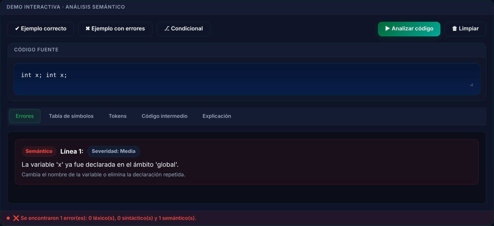

**Figura 3.** Antes (v1.5.7): `int x = "hola";` no detecta la incompatibilidad de tipos.

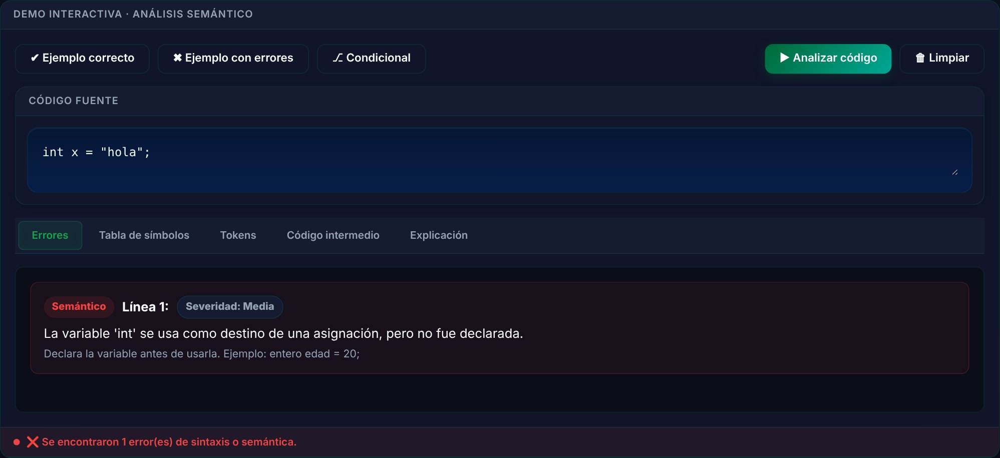

**Figura 4.** Después (v1.6.0): error semántico, no se puede asignar texto a entero.

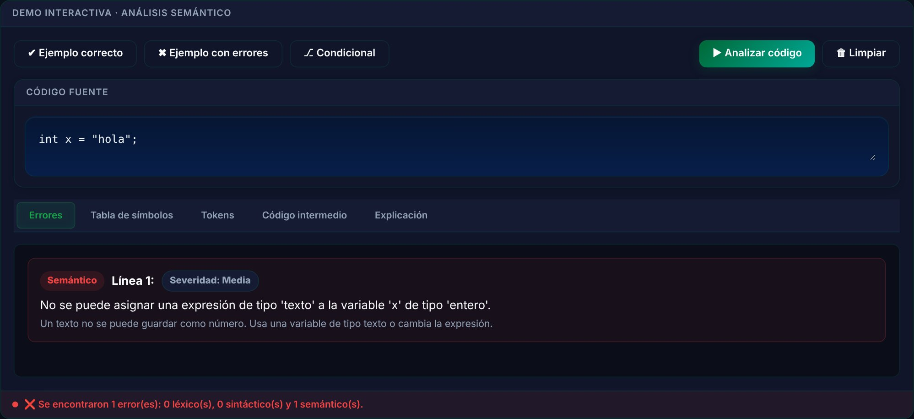

**Figura 5.** `int x = 10;`: declaración válida; `x` queda en la tabla de símbolos como entero.


**Figura 6.** `x = 20;` sin declaración previa: error por variable no declarada.


**Figura 7.** `int x = 10 + 2;`: operación válida.

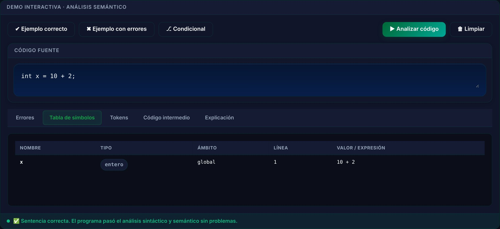

**Figura 8.** Ejemplo con errores: recuperación ante `eentero` y los 8 errores esperados.

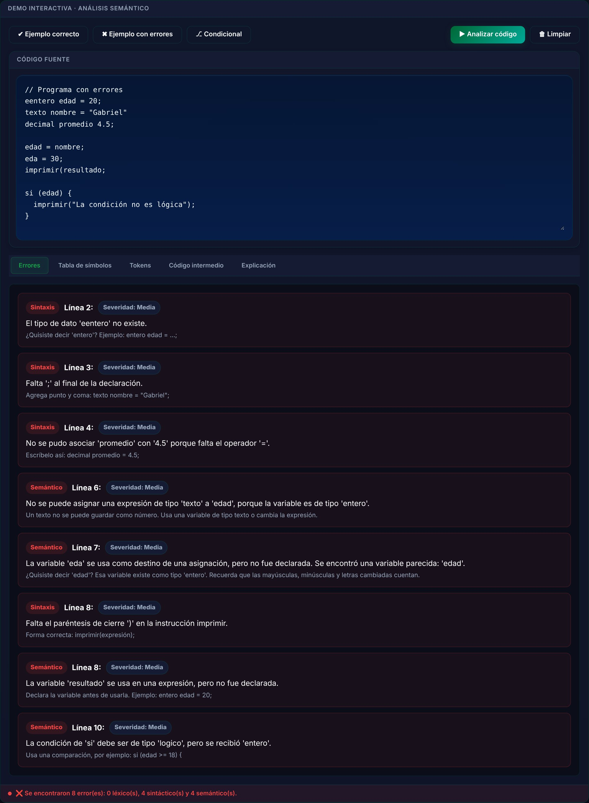

**Figura 9.** Ámbitos: `b` no es visible fuera del bloque del `si`.

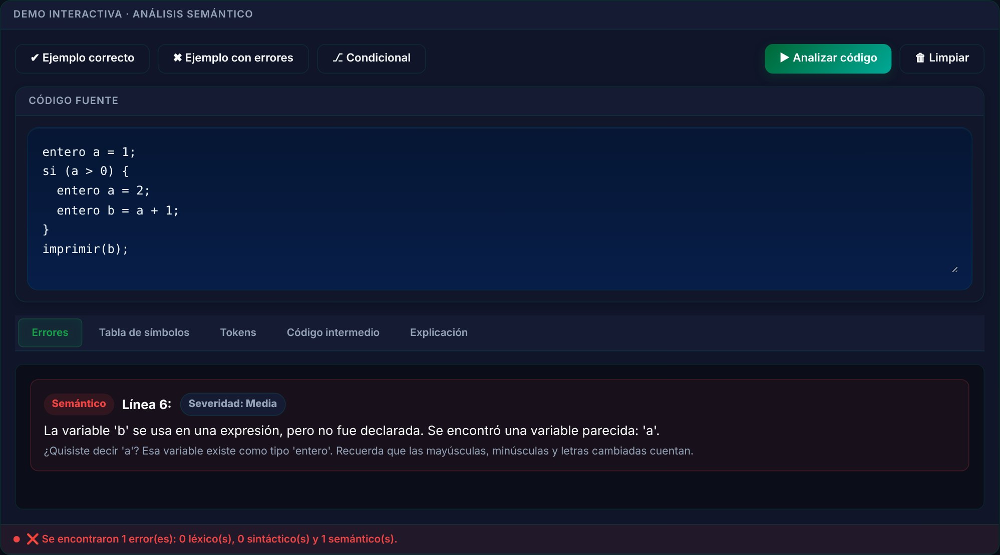

**Figura 10.** Tabla de símbolos: dos variables `a` en ámbitos distintos.

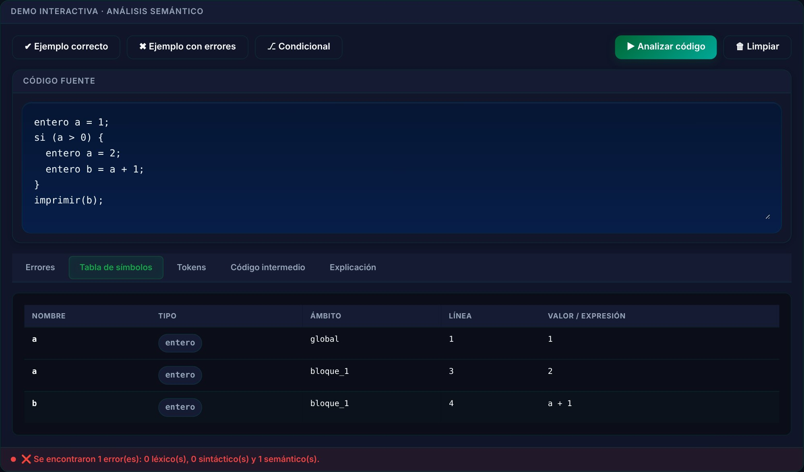

**Figura 11.** Errores léxicos diferenciados de los sintácticos.

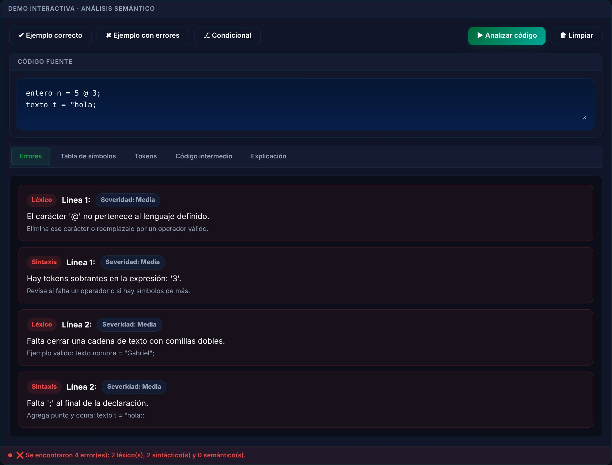

**Figura 12.** Advertencia por usar una variable sin valor (no cuenta como error).

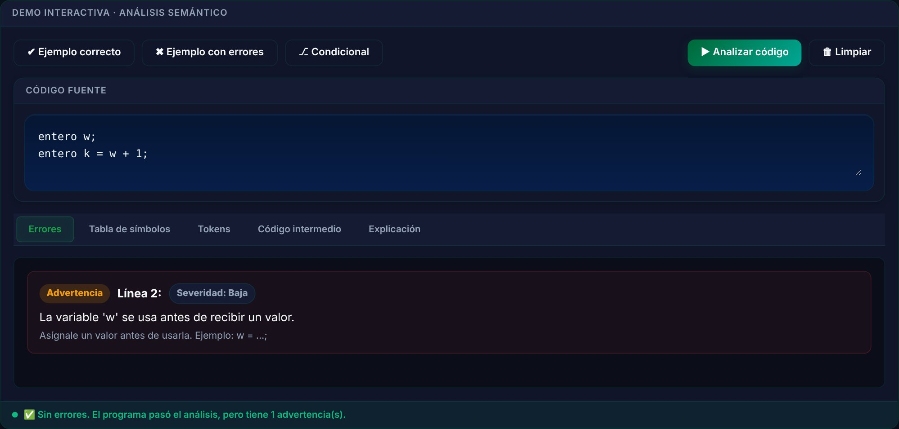

**Figura 13.** Pruebas automáticas sobre la versión original: 19/31.

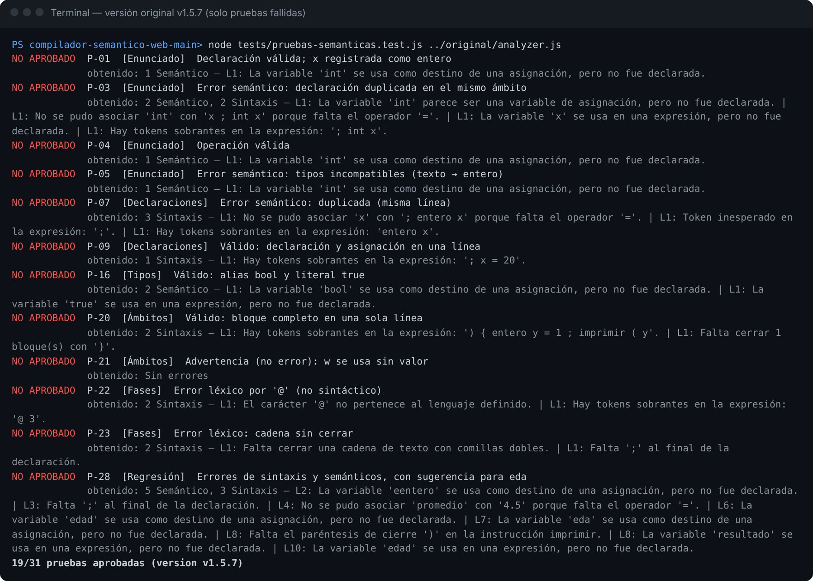

**Figura 14.** Pruebas automáticas sobre la versión corregida: 31/31.

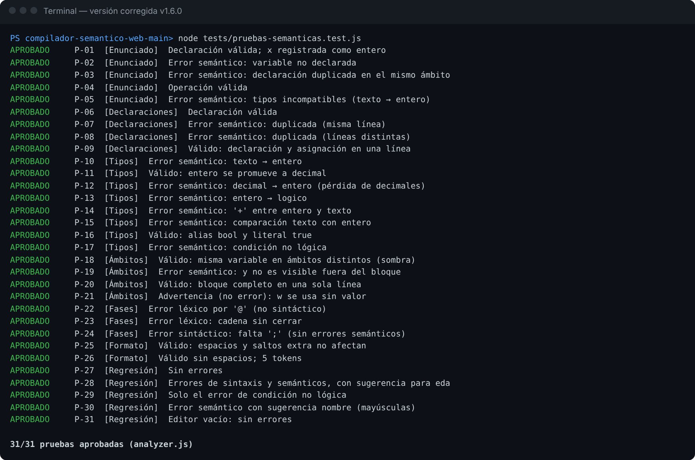

